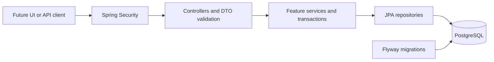

# Architecture and technology

## Baseline

| Concern | Decision |
|---|---|
| Language | Java 25, no preview features. |
| Application | Spring Boot 4.1.x, supported stable patch selected and pinned when scaffolding. |
| HTTP | Spring MVC / Spring Web, JSON DTOs and Bean Validation. |
| Persistence | Spring Data JPA / Hibernate, PostgreSQL 18. |
| Schema | Flyway, including PostgreSQL database support where required by the chosen dependency set. |
| Build | Maven with a committed Wrapper; Spring Boot dependency management for managed libraries. |
| Security | Spring Security, server-side HTTP session, framework PasswordEncoder. |
| API docs | springdoc-openapi 3.x compatible with the selected Boot minor; OpenAPI + Swagger UI for local/demo use. |
| Tests | JUnit Jupiter from the selected Boot test stack, Spring test support, PostgreSQL Testcontainers. |
| Packaging | One application image, PostgreSQL image, Docker Compose. |
| CI | GitHub Actions: build, tests including integration tests, format check. |

At scaffolding, verify the exact patch versions and compatibility in official documentation, pin them and record them in [development/progress.md](development/progress.md). Do not infer a JUnit major from old tutorials, override Boot-managed Hibernate arbitrarily, or use floating `latest` image tags. Use the same PostgreSQL major in Compose and Testcontainers. No application has yet been compiled against this proposed stack.

## One modular monolith

One Maven module, one Spring application, one database. Feature packages provide understandable boundaries without a plugin framework or separate deployments.

```text
src/main/java/dev/bartmilo/boxingacademy/
  BoxingAcademyApplication.java
  identity/       # Users, profiles, authentication and authorization support
  schedule/       # Rooms, groups, sessions and schedule reads
  membership/     # Plans, purchased passes, validity and snapshots
  payment/        # Owner-recorded payment receipts and activation orchestration
  booking/        # Reservations, cancellations, rosters and attendance
  shared/         # Small error/config/time helpers only
```

Keep controllers, DTOs, services and repositories close to their feature. Add subpackages only when size makes them useful. Use constructor injection, concrete services and small explicit mappers. Do not create service interfaces, generic base entities/controllers or mapper libraries by default. Spring Data repository interfaces are appropriate framework contracts.



## Dependencies and transaction ownership

- identity provides authenticated user identity, roles and read-only profile information to other features; it does not depend on booking/payment.
- schedule owns sessions; membership owns pass snapshots; payment orchestrates recording a receipt and activation of a pass.
- booking orchestrates seat and entry allocation and class cancellation, accessing session and membership rows inside a single transaction.
- A session cancellation HTTP route belongs to schedule, but may call a booking-side cancellation use case. The schedule service must not call booking while booking calls back into schedule services; keep the orchestration direction explicit.
- In this one-module project, explicit cross-feature repository access inside an orchestration service is acceptable. Avoid abstraction layers solely to hide a local database transaction.
- Put `@Transactional` on the service that owns the complete mutation. Do not scatter separate transactions across its steps or call a gateway inside the transaction.
- Map to response DTOs inside the service transaction where needed. Disable Open Session in View; manage fetches deliberately.

The transaction/lock order in business-rules.md is part of the architecture, not a testing detail.

## Authentication and future frontend

Use Spring Security sessions, not a custom JWT/refresh-token system. The frontend can be served behind the same origin as `/api`. A separately hosted development UI needs an explicit allowed CORS origin and credentialed requests; never combine credentials with wildcard origins.

- Provide a CSRF-token endpoint. Require its token for unsafe methods, including login and logout. Acquire a fresh token after login/logout because the security framework may rotate it.
- Use standard form-login processing with email/password form fields and JSON success/error handlers. No HTML redirects in the API. Return current-user DTOs separately.
- Session cookie: HttpOnly, SameSite=Lax, Secure for HTTPS deployments. Local HTTP may use a clearly scoped development configuration. Do not disable CSRF to make Swagger work.
- Let Spring Security rotate the session ID on authentication; invalidate the session on logout.
- Use the framework's delegating password encoder; never store plaintext or log credentials. Owner account-creation requests contain an initial password, which is never returned by read endpoints. Members can change their password with the current password; invalidate all their tracked sessions afterward, using Spring Security session tracking/SessionRegistry with the required lifecycle configuration. Cover this behavior with two simultaneous sessions in a test, not only the current cookie.
- In-memory sessions are enough for one instance; restart logs users out. If durable sessions become necessary, add Spring Session JDBC and its maintained schema as a separate justified change.
- Load/check account ACTIVE status for authenticated requests so an administratively blocked account cannot retain access via an existing session. V1 has no public status-change endpoint.
- Return only roster data needed by trainers (member ID/name, booking and attendance state), not financial details or contact data by default.

## Runtime and configuration

Use typed configuration for club timezone and allowed frontend origins. Business times come from an injected Clock. Persist instants; convert to club-local dates only where the domain requires it.

Database URL/credentials and owner bootstrap credentials come from environment/configuration outside source control. Provide `.env.example` with placeholders when implementation starts. No committed real passwords, API keys or personal demo records.

Demo data initialization is opt-in, local-only and repeat-safe. Normal startup must not seed public default credentials. A fresh V1 owner is bootstrapped using an explicit local/admin action; it must not create a new owner on every restart.

Expose a minimal health endpoint through Actuator; no sensitive management endpoints. Build a non-root application container. Compose should wait for database readiness and bind published demo ports to loopback by default. Stop gracefully and document startup failures.

## Official compatibility references

Checked on 2026-10-23; recheck exact patches when scaffolding:

- [Spring Boot system requirements](https://docs.spring.io/spring-boot/system-requirements.html): supports Java 25; Maven support is documented here.
- [springdoc-openapi](https://springdoc.org/): use its Boot compatibility matrix, not a Boot 3 / springdoc 2 example.
- [Spring Security CSRF](https://docs.spring.io/spring-security/reference/servlet/exploits/csrf.html): cookie-authenticated APIs require deliberate CSRF handling.
- [PostgreSQL 18 range types](https://www.postgresql.org/docs/18/rangetypes.html): range overlap and exclusion constraints for room/trainer scheduling.
